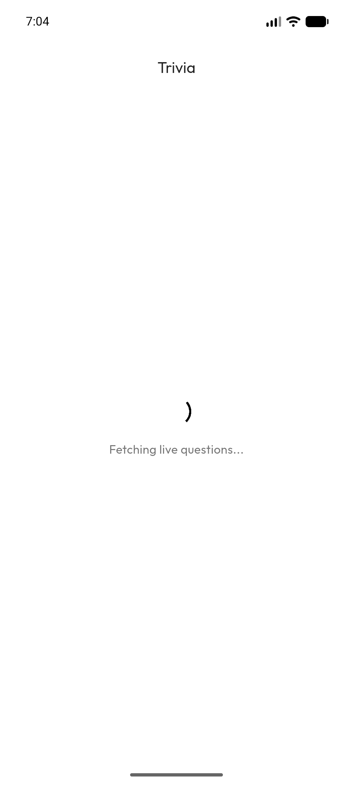
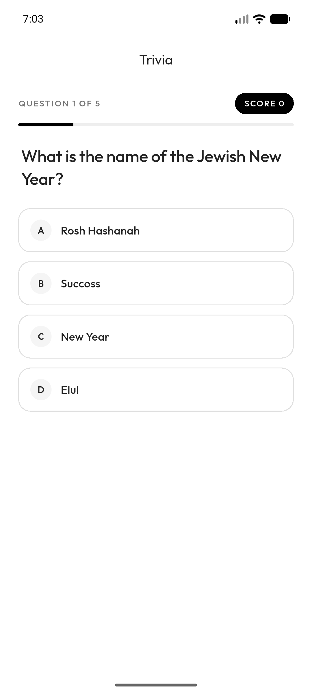
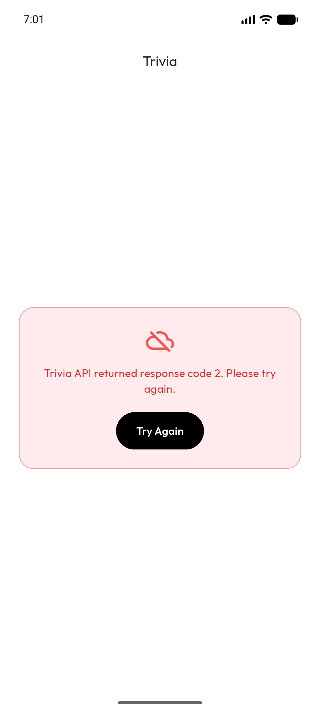

# CSC 4360 - In-Class Activity 15: API-to-Cloud Trivia Showdown

**Name:** Adi Tauqir (Undergraduate)  
**Course:** CSC 4360 - Mobile Application Development  
**Repository:** https://github.com/aditauqir/inclass-15.git

---

## Overview & Setup

How to get started:

1. **Clone the repo and get packages:**
   ```bash
   git clone https://github.com/aditauqir/inclass-15.git
   cd inclass-15
   flutter pub get
   ```

2. **API configuration:**
   - The app requests five easy, multiple-choice general-knowledge questions from Open Trivia Database:
     ```text
     https://opentdb.com/api.php?amount=5&category=9&difficulty=easy&type=multiple
     ```
   - No API key is required. Dependencies: `http` and `google_fonts`.
   - Android internet access is declared in `android/app/src/main/AndroidManifest.xml`.
   - Before using a response, the app validates HTTP `200`, API `response_code == 0`, and a non-empty `results` list.

3. **Run the App:**
   Launch an Android emulator or connect a physical device:
   ```bash
   flutter run
   ```

4. **Run Tests & Static Analysis:**
   ```bash
   flutter analyze
   flutter test
   ```

---

## Implemented Features

The app pulls 5 easy trivia questions from Open Trivia DB using the http package. It checks for HTTP 200 and API response_code 0 before parsing anything, cleans out weird HTML entities like &quot; and &amp;, and shuffles the 4 choices so the answer is random. While it fetches you get a loading spinner, and if wifi drops or the API errors out it shows a red error panel with Try Again instead of crashing. During the round you get one pick per question where wrong turns red and right turns green, updates the score once, and walks through all 5 questions. At the end it shows your final score with a Play Again button to restart fresh and a Sync with Cloud action that pushes the score to Firestore and shows the returned document ID once confirmed.

---

## Verification Results

| Test | Action & Expected Path | Observed Result | Status |
| :--- | :--- | :--- | :--- |
| **T1** | **Live fetch** | Request five questions; expect loading then a usable round | Spinner replaced by 5 live questions; progress and options rendered | **Pass** |
| **T2** | **Answer feedback** | Select a wrong option, then review the round | Selected option red, correct answer green, score unchanged | **Pass** |
| **T3** | **One-answer guard** | Tap multiple options on the same question | First answer locked; repeated taps cannot add points | **Pass** |
| **T4** | **Completion and sync** | Finish all five questions and sync score | Final score displayed; Firestore write confirmed with document ID | **Pass** |

### Screenshots

| Screenshot | What it demonstrates | Preview |
| :--- | :--- | :---: |
| **`loading.png`** | Spinner and "Fetching live questions..." while the request is in flight. |  |
| **`question.png`** | Question 1 of 5 with progress, score, and four live options. |  |
| **`feedback.png`** | Wrong choice red, correct answer green, score unchanged. |  |
| **`results.png`** | Round complete at 4 / 5, with the Sync with Cloud action. |  |
| **`replay.png`** | Play Again starts a new round with the score back at 0. |  |
| **`sync.png`** | Firestore write confirmed, with the new document ID shown. |  |
| **`error.png`** | API response code 2 shown as a readable error with Try Again. |  |
