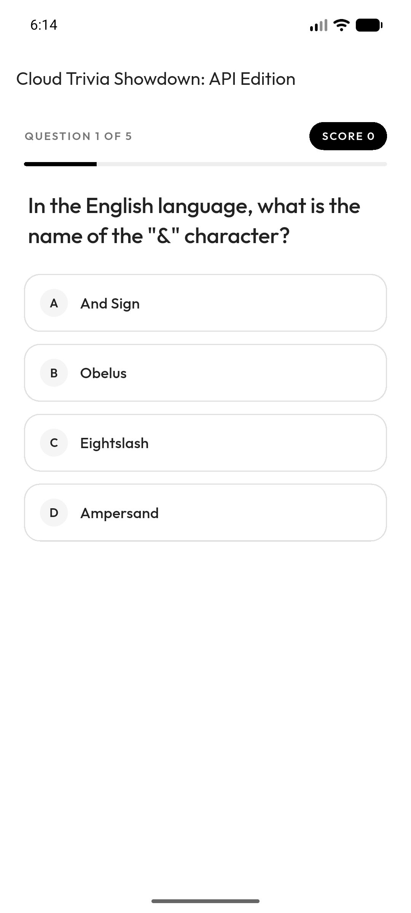
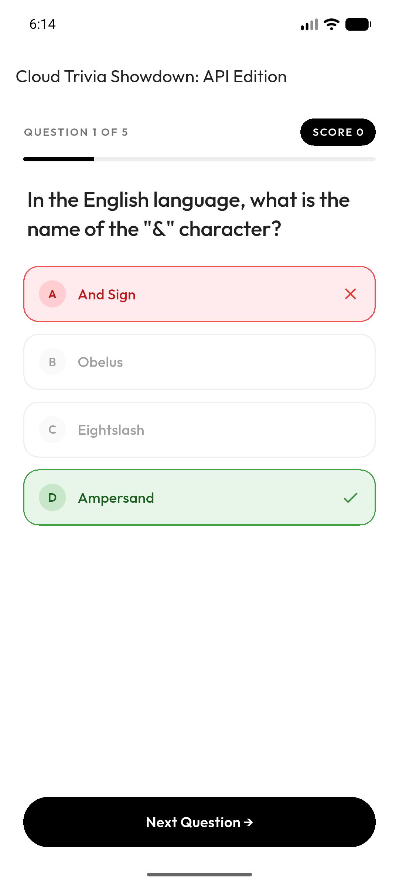
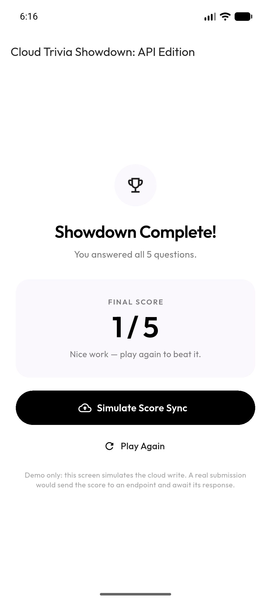
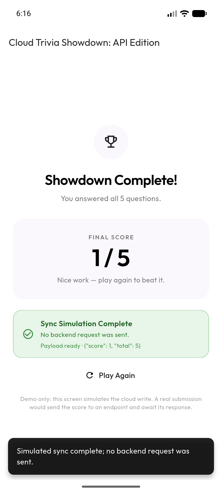

# CSC 4360 - In-Class Activity 15: API-to-Cloud Trivia Showdown

**Name:** Adi Tauqir (Undergraduate)  
**Course:** CSC 4360 - Mobile Application Development  
**Repository:** https://github.com/aditauqir/inclass-15.git

---

## Overview & Setup

How to get started:

1. **Clone the repo and get packages:**
   ```bash
   git clone https://github.com/aditauqir/inclass-15.git
   cd inclass-15
   flutter pub get
   ```

2. **API configuration:**
   - The app requests five easy, multiple-choice general-knowledge questions from Open Trivia Database:
     ```text
     https://opentdb.com/api.php?amount=5&category=9&difficulty=easy&type=multiple
     ```
   - No API key is required. Dependencies: `http` and `google_fonts`.
   - Android internet access is declared in `android/app/src/main/AndroidManifest.xml`.
   - Before using a response, the app validates HTTP `200`, API `response_code == 0`, and a non-empty `results` list.

3. **Run the App:**
   Launch an Android emulator (verified on the **Vixel 6a**, Android 17 / API 37.1) or connect a physical device:
   ```bash
   flutter run
   ```

4. **Run Tests & Static Analysis:**
   ```bash
   flutter analyze
   flutter test
   ```

---

## Implemented Features

**REST Client and Question Model (`lib/main.dart`)**: Fetches five questions with the `http` package, decodes the JSON body, verifies transport and API-level status, and maps each result through `Question.fromJson` into question text, correct answer, and shuffled options.

**Async State Handling**: A spinner is visible while the request is in flight. Server errors, connection failures, timeouts, invalid API response codes, and empty results all reach a red error panel with a Try Again action. A round ID guard prevents a stale response from overwriting a newer round.

**Entity Cleanup**: Decodes common named entities (`&quot;`, `&ldquo;`, `&rdquo;`, `&amp;`, and more) plus decimal and hexadecimal numeric entities before display, so raw markup never reaches the UI.

**Round and Feedback Loop**: Shows the question number, progress bar, current score, question text, and four shuffled options. Only the first answer is accepted; the correct choice turns green, an incorrect selection turns red, and the correct answer is always revealed. Continue advances the question and clears selection state.

**Final Score and Replay**: After five questions, the results screen shows the final score out of the loaded question count, offers score sync, and provides Play Again, which resets all round state before requesting fresh questions.

**Simulated Cloud Submission**: *Simulate Score Sync* builds a payload with round ID, final score, total questions, and a UTC timestamp, then demonstrates the asynchronous write flow (disabled while pending, then confirmed). It is labeled honestly as a simulation: **no backend request is sent**; the payload is logged and previewed in the UI. A real write would POST that payload and wait for the backend to confirm it.

**Design Language from In-Class 14**: Black-and-white Material 3 theme seeded from `Colors.black`, Outfit typography via `google_fonts`, white surfaces with soft lavender-gray (`#FAF8FD`) score panels, rounded 16–20 px containers, pill-shaped black primary buttons, uppercase gray labels, and red/green tinted feedback.

---

## Verification Results

| Test | Action & Expected Path | Observed Result | Status |
| :--- | :--- | :--- | :--- |
| **T1** | **Live fetch** | Request five questions; expect loading then a usable round | Spinner replaced by 5 live questions; progress and options rendered | **Pass** |
| **T2** | **Answer feedback** | Select a wrong option, then review the round | Selected option red, correct answer green, score unchanged | **Pass** |
| **T3** | **One-answer guard** | Tap multiple options on the same question | First answer locked; repeated taps cannot add points | **Pass** |
| **T4** | **Completion and sync** | Finish all five questions and simulate sync | Final score displayed; payload preview and "No backend request was sent." shown | **Pass** |

**Static analysis:** `flutter analyze` — no issues found.  
**Tests:** `flutter test` — 2 passed (JSON/entity parsing and loading/error state).

### Screenshots

| Live question | Answer feedback |
| :---: | :---: |
|  |  |

| Final score | Sync simulation |
| :---: | :---: |
|  |  |

---

## Notes and Limitations

- The HTTP call intentionally stays inside the screen state class, matching the starter. A production version would extract a `TriviaService` and model the request as an explicit state object.
- Score submission is simulated. Persisting to Firestore or another shared backend would require adding that service, sending the payload, and handling the actual server result rather than only a local delay.
- Open Trivia Database may rate-limit repeated requests; use the retry action or wait briefly if a request is rejected.

## Official References

- [Open Trivia Database API configuration](https://opentdb.com/api_config.php)
- [Flutter cookbook: Fetch data from the internet](https://docs.flutter.dev/cookbook/networking/fetch-data)
- [Dart `http` package](https://pub.dev/packages/http)
